# 📊 Awesome Big Data SQL Analytics

  

  
  
  
  
  
  

---

## 🌟 Top Big Data SQL Analytics Ecosystem

**Curated List of SaaS Products & Open-Source GitHub Projects**  
*Focused on Distributed Query Engines, Lakehouse Analytics, Vectorized Execution & Self-Hosted SQL Federation*  

> **Last updated: October 2026**

A community-driven, SEO-optimized knowledge repository tracking state-of-the-art **Big Data SQL Analytics engines**, **modern cloud data warehouses**, **open data lakehouses**, and **real-time OLAP databases**. Whether querying petabyte-scale data lakes with Apache Iceberg, federating queries across hybrid multi-cloud environments, or embedding vectorized SQL compute in-process, this guide provides factual, verified insights with exact SaaS pricing models and open-source star rankings.

---

## 📑 Table of Contents

- [🌐 Sector Overview & Market Dynamics](#-sector-overview--market-dynamics)
- [☁️ SaaS & Hosted Platforms](#️-saas--hosted-platforms)
- [🐙 Open-Source GitHub Projects](#-open-source-github-projects)
- [🛠️ How to Contribute](#️-how-to-contribute)
- [💖 Support & Sponsorship](#-support--sponsorship)
- [📈 Star History](#-star-history)
- [⚠️ Disclaimer](#️-disclaimer)

---

## 🌐 Sector Overview & Market Dynamics

The global big data SQL analytics and lakehouse market is estimated at **$11.66 billion in 2026** and projected to reach **$28.04 billion by 2034** (CAGR ~11.59%). 

The sector is **moderately to highly fragmented** rather than winner-take-all: no single vendor holds a monopoly because modern enterprise architectures routinely combine hyperscaler managed warehouses (BigQuery, Redshift), dedicated cloud data platforms (Snowflake, Databricks), and open-source distributed engines (Trino, ClickHouse, DuckDB) across multi-cloud environments. Compute has decoupled from storage around open table formats like **Apache Iceberg**, preventing total vendor lock-in.

---

## ☁️ SaaS & Hosted Platforms

| Product | Description | Pricing | Free Tier Limit | Company Size (Revenue/Valuation) |
| :--- | :--- | :--- | :--- | :--- |
| **[Amazon Redshift](https://aws.amazon.com/redshift/)** | Provisioned or Serverless data warehouse on AWS. | **Serverless**: **$0.375/RPU-hour** (US East). **RA3.4xlarge**: $3.26/node-hour. | **$300 Serverless credits** valid for **90 days**. Free trial only (no permanent free tier). | **AWS (Amazon)**: **$128.7B annual revenue** (2025). |
| **[Google BigQuery](https://cloud.google.com/bigquery)** | Serverless data warehouse with on-demand or slot-based capacity. | **On-demand**: **$6.25 per TiB scanned** (Standard Edition: $0.04/slot-hour). | **Permanent Free Tier**: **1 TiB scanned/month** + **10 GB active storage/month**; Sandbox mode available with no credit card required. | **Google Cloud (Alphabet)**: **$70B+ annual revenue run-rate** (2025–2026). |
| **[Databricks SQL](https://www.databricks.com/)** | Lakehouse SQL warehouse built on Spark and Delta Lake. | **SQL Warehousing**: **$0.22/DBU** (Serverless SQL Warehouse: **$0.70/DBU**). Total compute cost ~2–3x DBU with cloud infra. | **14-day free trial** with full platform capabilities. Free trial only (no permanent free tier). | **Private**: **$190B valuation**, **$7B+ annual revenue run-rate** (2026). |
| **[Dremio Cloud](https://www.dremio.com/)** | Lakehouse query engine with semantic layer and Arrow-based acceleration. | **Standard Pay-As-You-Go**: **$0.20 per DCU** (Dremio Compute Unit) per hour (e.g. Small engine = 64 DCUs/hr = $12.80/hr). | **Permanent Free Tier (Standard)**: Up to **10 users**, capped engine sizes, up to 200 tables & 1,000 views. No time limit. | **SAP (Acquired)**: Parent revenue **€36.8B (~$40B)**; Dremio peak standalone valuation was **$2B** (~$50M–$66M ARR). |
| **[Snowflake](https://www.snowflake.com/)** | Cloud data warehouse with decoupled compute/storage and multi-cluster scaling. | **Standard Edition**: **$2.00/credit** (~$226/mo for 1 Medium warehouse running 8 hrs/day + 2 TB storage). Enterprise: **$3.00/credit**. | **30-day free trial** with **$400 in free usage credits**. Free trial only (no permanent free tier). | **Public (NYSE: SNOW)**: **$4.68B annual revenue** (FY2026). |
| **[Starburst Galaxy](https://www.starburst.io/)** | Managed Trino service for lakehouse analytics and federation. | **Pro**: **$0.50/credit**. **Enterprise**: **$0.75/credit**. **Mission-Critical**: **$1.00/credit**. | **Permanent Free Tier**: **3 concurrent clusters**, standard execution mode, free forever; plus **30-day trial with $500 compute credits**. | **Private**: **$3.35B valuation** (Series D), **$100M+ ARR**. |

---

## 🐙 Open-Source GitHub Projects

*Sorted by GitHub Stars_Count (Descending)*

1. **[ClickHouse](https://github.com/ClickHouse/ClickHouse)**   
   ⚡ **The columnar OLAP speed champion.** Native C++ real-time analytics database with vectorized query execution. Scales to billions of rows per second for high-throughput operational dashboards, log analytics, and time-series aggregation.

2. **[Apache Spark](https://github.com/apache/spark)**   
   🚀 **The unified distributed analytics powerhouse.** Massive ecosystem combining large-scale batch ETL, Spark SQL, streaming workloads, and ML pipelines running across Kubernetes or standalone clusters.

3. **[DuckDB](https://github.com/duckdb/duckdb)**   
   🦆 **The in-process analytical database (SQLite for Analytics).** Zero-dependency columnar engine with vectorized SIMD execution. Seamlessly queries Parquet, CSV, Arrow, and Iceberg directly in Python, R, Node, and browser environments.

4. **[Apache Flink](https://github.com/apache/flink)**   
   🌊 **Stateful distributed stream processing engine.** Powers mission-critical event-driven architectures with continuous Flink SQL, sub-second latency, and exactly-once processing guarantees across large-scale streams.

5. **[Cube](https://github.com/cube-js/cube)**   
   🧊 **The Universal Semantic Layer & SQL API.** Centralizes metrics, access control, and caching across cloud data warehouses and SQL query engines to power BI tools, LLMs, and embedded data applications.

6. **[Apache Arrow](https://github.com/apache/arrow)**   
   🏹 **The cross-language in-memory columnar standard.** Foundation for next-generation zero-copy analytical execution, high-throughput tabular inter-process communication (IPC), and Arrow Flight SQL data interchange.

7. **[Presto](https://github.com/prestodb/presto)**   
   🔍 **Distributed SQL query engine for big data.** Originally developed at Meta; massively parallel processing (MPP) architecture running interactive analytics and ad-hoc SQL over exabyte-scale data lakes with Velox native acceleration.

8. **[Apache Doris](https://github.com/apache/doris)**   
   ⚡ **High-performance real-time analytical database.** MPP architecture with columnar storage, inverted index support, and native vectorized execution for high-concurrency sub-second reporting and ad-hoc exploration.

9. **[Apache Druid](https://github.com/apache/druid)**   
   ⏱️ **Real-time analytics database for streaming events.** Optimized for low-latency operational telemetry, user-facing analytics applications, and high-volume event ingestion from Apache Kafka.

10. **[Trino](https://github.com/trinodb/trino)**   
    🌐 **The distributed SQL federation standard.** Massively parallel query engine that queries data across Iceberg, Delta Lake, PostgreSQL, MySQL, and cloud object stores (S3/GCS/Azure) without data migration.

11. **[StarRocks](https://github.com/StarRocks/starrocks)**   
    ⭐ **Next-generation sub-second lakehouse engine.** Fully vectorized C++ query engine featuring cost-based optimization (CBO) and automated materialized views for real-time dashboards and federated lake queries.

12. **[Apache DataFusion](https://github.com/apache/datafusion)**   
    🦀 **Extensible Rust-native SQL query engine.** Vectorized in-memory compute powered by Apache Arrow. Used as the core query execution engine for modern distributed and embedded databases.

13. **[Apache Iceberg](https://github.com/apache/iceberg)**   
    ❄️ **The open lakehouse table format standard.** High-performance ACID table format enabling safe concurrent writes, partition evolution, time travel, and cross-engine portability across Spark, Trino, Flink, and Snowflake.

14. **[Delta Lake](https://github.com/delta-io/delta)**   
    🔺 **Open-source storage framework for Lakehouse.** Provides ACID transactions, scalable metadata handling, and unified batch/streaming data processing on cloud object storage.

15. **[Materialize](https://github.com/MaterializeInc/materialize)**   
    🔄 **The streaming SQL database.** Continuously ingests live events and PostgreSQL/MySQL change data capture (CDC), maintaining complex materialized views with sub-second latency and standard Postgres SQL compatibility.

16. **[Apache Polaris](https://github.com/apache/polaris)**   
    🧭 **Open source catalog for Apache Iceberg.** Interoperable, multi-engine catalog standard providing cross-cloud centralized access control, table discovery, and governance without vendor lock-in.

---

## 🛠️ How to Contribute

We welcome community contributions! Follow these steps to submit additions or improvements:

1. 🍴 Fork the repository on GitHub.
2. 📝 Add or update entries in `README.md` adhering to the table or list schema.
3. 🔗 Verify all URLs, pricing units, free tier limits, and GitHub Stars_Badges.
4. 🚀 Submit a Pull Request with a clear, concise summary of the addition.

---

## 💖 Support & Sponsorship

If you find this repository helpful for your data engineering, analytics architecture, or lakehouse projects:

- ⭐ **Star this repository** to show your support and help others discover it!
- 🍴 **Fork and share** with colleagues and the broader data community.
- ☕ **Buy me a coffee / Sponsor**: Support ongoing maintenance and curation via the [GitHub Sponsors Dashboard](https://github.com/sponsors/ishandutta2007).

Your support keeps this guide updated with the latest industry shifts, benchmarks, and project releases! 🙌

---

## 📈 Star History

---

## ⚠️ Disclaimer

- This is a **community-curated guide** intended for architectural reference—not commercial endorsement.
- **SaaS pricing varies significantly by actual consumption**: Listed rates reflect standard starting tiers; production enterprise workloads with high data concurrency, memory requirements, and egress can scale substantially.
- **Free tier evaluations**: Verify current vendor terms prior to enterprise sizing; serverless and credit-based trials expire after allocated usage limits or stated calendar durations.
- **Architectural trade-offs**: Native C++/Rust vectorized engines (ClickHouse, DuckDB, DataFusion) deliver unmatched performance on single-node or low-latency analytics; MPP distributed architectures (Spark, Trino, Presto) excel when horizontally scaling across clusters.
